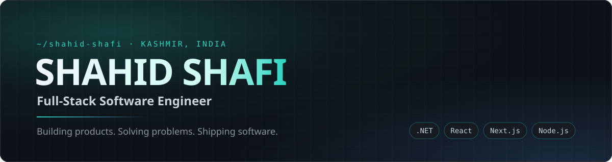
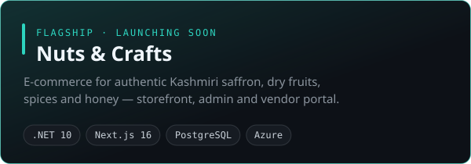
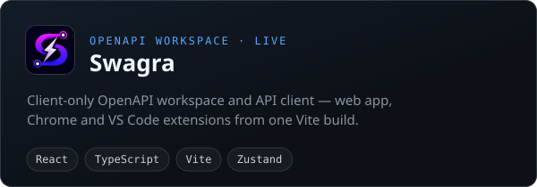
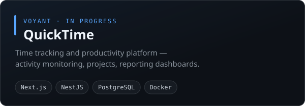
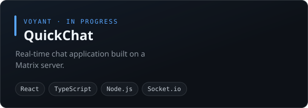
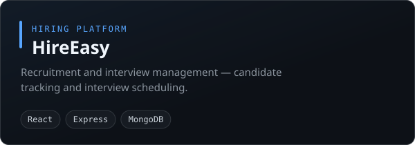
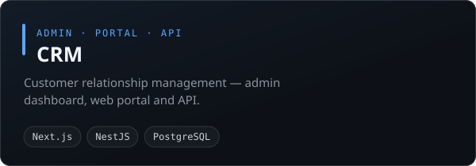
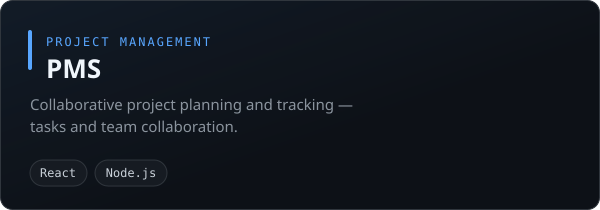

  
  
  
  

## About

I'm a full-stack software engineer in Kashmir with four years of shipping production web applications — React and Next.js on the front, .NET and Node.js on the back, PostgreSQL underneath. I like owning a feature end to end, from the database migration to the last loading state.

What I care about: clean architecture that stays readable a year later, systems that hold up under real traffic, and fast pages. Outside my day job I build my own products — right now, an online store for my family's saffron from Pampore.

I use Claude Code and Copilot daily, as an accelerator — never a substitute for understanding what ships.

## Currently building

| Project | What it is |
| :-- | :-- |
| **[Nuts&nbsp;&&nbsp;Crafts](https://nutsandcrafts.com)** | Authentic Kashmiri saffron, dry fruits, spices and honey, sold direct. Storefront, admin panel and vendor portal in one codebase — Razorpay and cash-on-delivery checkout, a stock ledger with reservations, WhatsApp order confirmation, product pages in 11 Indian languages. *Launching soon.* |
| **QuickTime** | Time tracking and productivity platform, at Voyant Consultancy Services. |
| **QuickChat** | Real-time chat application on a Matrix server, at Voyant Consultancy Services. |

## Featured projects

<table>
  <tr>
    <td width="50%"></td>
    <td width="50%"></td>
  </tr>
  <tr>
    <td width="50%"></td>
    <td width="50%"></td>
  </tr>
  <tr>
    <td width="50%"></td>
    <td width="50%"></td>
  </tr>
  <tr>
    <td colspan="2" align="center"></td>
  </tr>
</table>

Live: <a href="https://nutsandcrafts.com">nutsandcrafts.com</a> · <a href="https://swagra.vercel.app">swagra.vercel.app</a>. QuickTime and QuickChat are client work at Voyant; the source for every project here is private.

## Stack

<table>
  <tr>
    <td><b>Backend</b></td>
    <td></td>
    <td>C# · .NET · ASP.NET Core · Node.js · Express.js</td>
  </tr>
  <tr>
    <td><b>Frontend</b></td>
    <td></td>
    <td>React · Next.js · TypeScript · JavaScript · Tailwind CSS</td>
  </tr>
  <tr>
    <td><b>Data</b></td>
    <td></td>
    <td>PostgreSQL · SQL Server · MongoDB · Redis</td>
  </tr>
  <tr>
    <td><b>DevOps & tools</b></td>
    <td></td>
    <td>Docker · Azure · Linux · Git · GitHub</td>
  </tr>
</table>

## Experience

**Software Engineer** · Voyant Consultancy Services 
<code>Feb 2025 — present</code>

- **QuickTime** — building a time tracking and productivity management platform
- **QuickChat** — developing a real-time chat application on a Matrix server
- Working in a collaborative, agile team

**Software Engineer** · Inara Consultancy Services 
<code>Nov 2022 — Feb 2025</code>

- Built web applications in React, Next.js and modern JavaScript with cross-functional teams
- Implemented REST APIs for reliable frontend–backend communication
- Took part in code reviews and agile sprints; worked on performance optimisation
- Aligned technical solutions with business requirements

## GitHub

  
  

  

